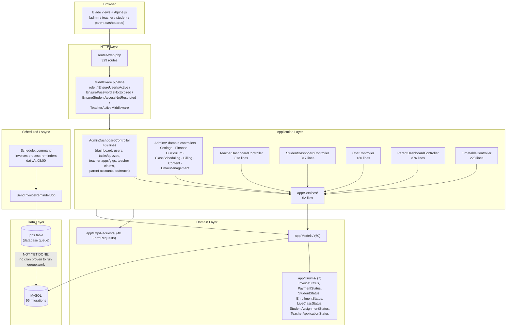
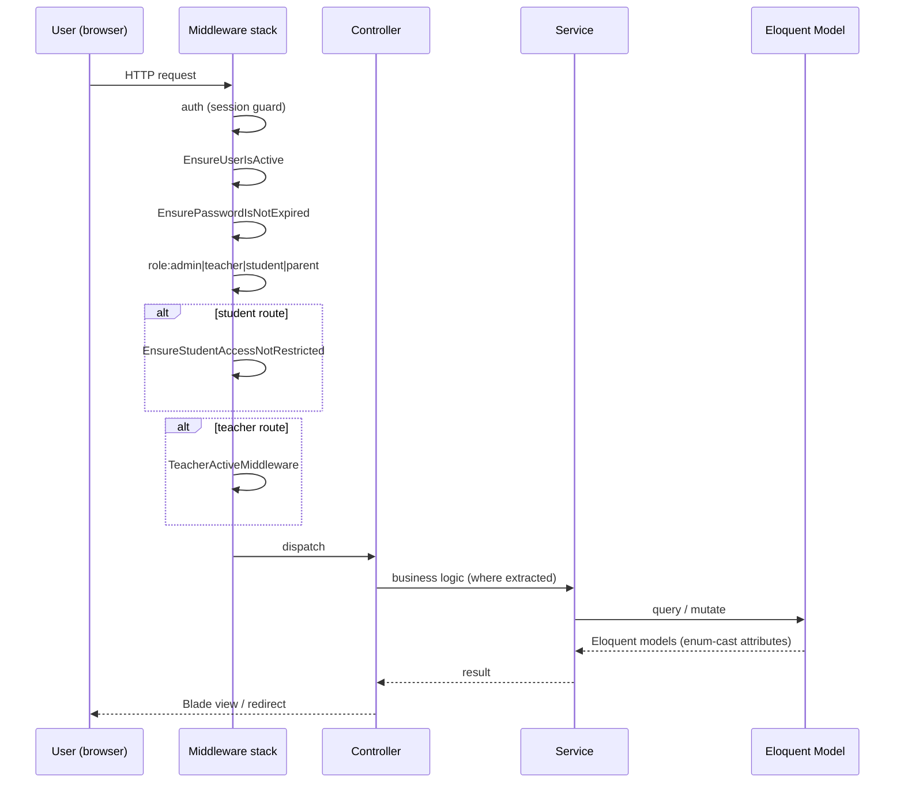
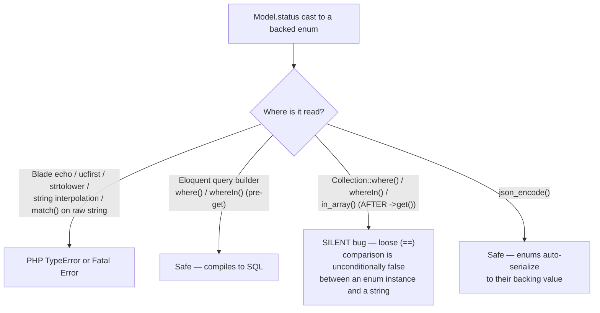

# Olympia Scholars — Architecture

**Status as of:** 2026-11-11, branch `khai-QA-refactor`. Last full rewrite was 2026-11-10 against Phases 0–5. This update layers in two same-day passes: the business-drift reconciliation (§11, four slices porting business features `main` had shipped that this branch never absorbed) and Phase 6 — CI pipeline + static analysis (§12), which closes the master plan's last unstarted phase. Verified the same way as always: `php artisan test`, `wc -l`, direct file reads, `git log`, not from memory of the previous version or design intent. Where something is planned but not yet built, it is marked **NOT YET DONE**.

Companion documents: [`implementation_plan.md`](../implementation_plan.md) (chatbox spec — now historical, see the notice at its top) and the QA/refactor master plan at `C:\Users\kyouscireul\.claude\plans\what-i-need-to-peppy-mitten.md`.

---

## 1. Stack

| Layer | Value | Verified via |
|---|---|---|
| Framework | Laravel v12.64.0 | `composer show laravel/framework` |
| PHP | `^8.2` (running 8.3.28) | `composer.json`, `php -v` |
| DB | MySQL (`DB_CONNECTION=mysql`) | `.env` |
| Queue driver | `database` (`QUEUE_CONNECTION=database`) | `.env` |
| Test DB | in-memory SQLite (`phpunit.xml`) | confirmed a legitimate target in Phase 1; also used ad hoc as a file-based DB for the Phase 5 FK/index audits since no live MySQL was reachable locally |
| Frontend | Blade + Alpine.js + Tailwind (no SPA framework) | `resources/views`, `tailwind.config.js` |
| Deployment target | Shared/cPanel hosting, no persistent worker process | Plan decision #4; **still unproven** — see §7, Phase 5a |

---

## 2. Component Overview

**Known architectural weak point, still unresolved:** the queue is configured and jobs are dispatched (`SendInvoiceReminderJob` daily via `invoices:process-reminders`), but nothing has been *proven* to consume the `jobs` table on the production host — no `queue:work` cron entry has been confirmed. This is Phase 5a, explicitly blocked on cPanel/infra access the Wanderer has to grant; everything else in Phase 5 that doesn't depend on it is done (§7).

### 2.1 Controller split since the last write-up (Phase 4)

`AdminDashboardController` was 1,030 lines at the start of this round of work (it had grown since the 2026-09-28 snapshot, which measured 3,449 — the 3,449→1,030 drop happened in an earlier, undocumented pass this doc never caught up to). It's now 388, split by domain into `Admin\SettingsController`, `Admin\FinanceController`, `Admin\CurriculumController`, and `Admin\ClassSchedulingController` (all new this phase), joining the pre-existing `Admin\BillingController`, `Admin\AdminContentController`, and `Admin\EmailManagementController`. `ParentDashboardController` went 539→376 via extraction into `Parent\ChildAccessService`/`Parent\BillingService`.

**Known gap, not yet addressed:** `Admin\BillingController` (560 lines) and `Admin\EmailManagementController` (586 lines) both already exceed the Phase 4 ~400-line guideline. Neither was named in the original Phase 4 audit (both are pre-existing, upstream-merged subsystems, not part of the six controllers that audit tracked), so they were never in scope for this round's split — surfaced here so it isn't silently missed next time the controller sizes are audited.

**2026-11-11 addendum:** `AdminDashboardController` grew 388→459 and `TeacherDashboardController` 292→313 during the business-drift reconciliation pass (§11) — new thin pass-through methods (`linkParentStudent`/`unlinkParentStudent`, 3 teacher-claim actions, `claimsIndex`/`storeClaim`/`updateClaimBankDetails`) delegating to 4 new services, not inline logic. Still well under the ~400-line guideline except where already noted above.

---

## 3. Request / Authorization Flow

`tests/Feature/RouteAuthorizationMatrixTest.php` (Phase 1) introspects the live route table at runtime — not a hand-maintained list — and asserts every `role:`-gated route rejects every other role and guests. It kept working unchanged through every controller rename in Phase 4, which was exactly the point of building it that way: a controller-class rename is invisible to a test that only looks at route names and middleware.

---

## 4. Chat Subsystem

The chatbox was fully consolidated in Phase 2 onto a single `Conversation`/`ChatMessage` stack (the legacy `Message`/`MessageController` stack and its table were deleted outright). `Chat\MessagingService` (1,217 lines / 24 methods) now holds essentially all of the logic that used to live in `ChatController`, which is down to 130 lines of pure route dispatch — message lifecycle (send, delta-poll via `since_id`, read receipts), attachments (upload + authenticated download), typing indicators, mute/archive/clear/delete, a parental-monitoring module (audited, logged to `chat_audit_logs`), and an admin module (contact search, status changes, per-user context).

`ChatController::authorizeContact` allows Parent↔Child (active guardianship only — a `pending` link still grants zero chat access) and enforces the teacher-enrollment whitelist both directions. `getDirectory()` (the "who can I start a new chat with" list) surfaces the counterpart correctly.

**Had zero direct test coverage until Phase 4/5's gap-closure pass** (`MessagingServiceContractTest`, 17 tests) beyond the role-matrix authorization tests (`ChatAuthorizationTest`) written in Phase 2. Writing that coverage caught a real bug: `getChildConversations()`'s audit-log call passes a null `conversation_id` for the `monitoring_session_started` action, but the migration meant to make that column nullable
(`2026_09_28_100002_make_conversation_id_nullable_in_chat_audit_logs.php`) had explicitly skipped itself on sqlite — dead code written against an older Laravel that needed `doctrine/dbal` for `->change()`; Laravel 12 doesn't. Fixed.

---

## 5. Enum / Domain Modeling

Seven `status`-bearing models use native PHP backed enums (`app/Enums/`): `InvoiceStatus`, `PaymentStatus`, `StudentStatus`, `EnrollmentStatus`, `LiveClassStatus`, `StudentAssignmentStatus`, `TeacherApplicationStatus`. `LiveClass.status` is a computed accessor (derives Upcoming/Live/Completed from `scheduled_at`/`duration_minutes`), not a simple `$casts` entry, because the underlying MySQL column is a native `enum('upcoming','live','completed')`.

Phase 3 found and fixed 2 TypeError crash sites, 2 live silent-data-bug methods (`ParentDashboardController::dashboard()`/`payments()`), and one login-gate security regression (`User::isAccountActive()` comparing a raw string against the newly-enum-cast `Student.status`, which would have let a restricted/inactive student bypass the login gate). `EnrollmentStatus` had zero test references of its own until Phase 4/5's `EnrollmentStatusTest` — closed, including a value-correctness proof that `whereIn()` with enum cases resolves correctly.

**Known, explicit gap, unchanged:** `FeeStructure` still uses `const STATUS_*` string constants — never one of the plan's seven named Phase 3 models.

---

## 6. Subsystems Not Previously Documented

These exist in the codebase (merged from upstream between the 2026-09-28 write-up and now) but were never recorded here. Listed so this document stops being wrong about what's actually in the app:

| Subsystem | Location | What it does |
|---|---|---|
| **Billplz payment gateway** | `Services\Billplz\BillplzService`, `Http\Controllers\Billing\{BillplzController,InvoiceController,PaymentController}` | Online banking checkout (sandbox + live endpoints, API key resolved from DB `Setting` with a config fallback). Falls back to a mock FPX success path when no gateway credentials are configured (see `Parent\BillingService::payInvoice()`). |
| **Email management** | `Services\Email\{AudienceResolverService,EmailAutomationService,EmailSendingService,EmailTemplateRenderer,EmailVariableRegistry}`, `Http\Controllers\Admin\EmailManagementController` | Templated transactional/marketing email: audience resolution with suppression-list respect, idempotent automation triggers (keyed, so the same event can't double-fire), campaign batching (`ProcessCampaignBatchJob`), and a variable registry that drives both the template editor's autocomplete and the renderer's HTML-escaping. |
| **Grading engine** | `Services\Grading\DiagnosticGradingEngine` | Evaluates student answers against admin-authored rule ASTs (parsed separately), computing awarded marks, partial credit, and transparent per-question feedback — used by the diagnostic-test flow, distinct from a teacher's manual grading of regular tasks. |
| **Attendance** | `Services\AttendanceService` (student-facing: join/rejoin attempts, correction requests) + `Services\Admin\AttendanceService` (admin-facing: policy settings, CSV export) | Two services, split by audience rather than by data — both operate on `student_attendances`/`attendance_events`/`attendance_correction_requests`. |
| **Interactive PDF assignments** | `Http\Controllers\InteractiveAssignmentController`, `Services\PdfDiagnosticParser` | Lets a student annotate/fill a PDF assignment page-by-page (`submission_pages`), auto-parses question/option/page structure from an uploaded PDF for admin-authored diagnostic tests, and renders a read-only interactive viewer for teacher/admin review. |

---

## 7. QA / Refactor Phase Status

Per `C:\Users\kyouscireul\.claude\plans\what-i-need-to-peppy-mitten.md` (v2) and the follow-up gap-closure plan at `C:\Users\kyouscireul\.claude\plans\playful-dazzling-moon.md`:

| Phase | Status | One-line result |
|---|---|---|
| 0 — Containment | ✅ Done | Closed an unauthenticated parent-child-hijack chain; randomized/emailed all previously-derivable passwords; throttled account creation |
| 1 — Safety Net | ✅ Done | Runtime route-authorization matrix; model factories; dashboard smoke tests |
| 2 — Chat Consolidation | ✅ Done | Single `Conversation`/`ChatMessage` stack; legacy `Message` stack deleted; Parent↔Child chat enabled |
| 3 — Enums / Domain Modeling | ✅ Done | 7 backed enums; 2 crash sites + 2 silent-data-bug methods + 1 login-gate security regression found and fixed |
| 4 — Modularity | ✅ Done | 4th missed route closure extracted; 22 inline `validate()` → FormRequests; both oversized controllers (Admin 1030→388, Parent 539→376) split under 400 lines — see §2.1 for the 2 pre-existing controllers this didn't cover |
| 5 — Scalability | ✅ Done except 5a | `$fillable` tightened on all 5 flagged models (redone clean after an earlier attempt broke 313 tests → 63 failures); FK audit clean (no bugs); 2 genuinely-missing indexes added; 6 real N+1 sites fixed; a query-budget test harness locks in the 2 fixes with real regression risk. **5a (queue-worker proof on the live cPanel host) blocked on Wanderer/infra access — not done.** |
| 6 — CI & Static Analysis | ✅ Done | `.github/workflows/ci.yml` (push/PR, any branch); Pint adopted (one-time 319-file formatting pass, verified non-breaking); Larastan installed at level 5 with a 925-finding baseline so CI only fails on new issues — see §12 |

---

## 8. Test Suite

| Metric | Value | Verified via |
|---|---|---|
| Test methods | 378 (376 passing, 2 intentionally skipped — the full-page messenger, disabled per repo-owner direction) | `php artisan test` |
| Assertions | 1,145 | `php artisan test` output |
| Query-budget regression tests | 2 (`OverviewServiceBuildStudentDataTest`, `AcademicProgressServiceQueryBudgetTest`), via `Tests\Concerns\CountsQueries` | Phase 5e |

The suite has been the regression gate for every change since Phase 1 — green before and after every commit in Phases 3–5 and again through the §11 reconciliation pass, including two multi-day efforts (the AdminDashboardController split and the `$fillable` tightening redo) that were run in small, independently-verified slices specifically so a regression could be isolated to one commit rather than discovered at the end of a large batch. The §11 slices followed the same discipline: 349→354→361→373→376 passing, one slice per commit, full suite re-run after each.

---

## 9. Current Metrics Snapshot

| Metric | Value | Verified via |
|---|---|---|
| Models | 60 | `find app/Models -name "*.php"` |
| Services | 52 | `find app/Services -name "*.php"` |
| FormRequests | 40 | `find app/Http/Requests -name "*.php"` |
| Model factories | 40 | `find database/factories -name "*.php"` |
| Migrations | 96 | `ls database/migrations` |
| Routes | 338 | `grep -c "Route::" routes/web.php` |
| Backed enums | 7 | `ls app/Enums` |
| `const STATUS_*` constants remaining | 4 (all `FeeStructure`, explicitly out of Phase 3 scope) | `grep -c "const STATUS_"` |
| CI workflow / Larastan / Pint config | all three now exist (§12) | `.github/workflows/ci.yml`, `phpstan.neon`, `pint.json` |
| Larastan baseline findings | 925 (level 5, `app/` only) | `phpstan-baseline.neon` |

---

## 10. Deliberately Deferred / Not Yet Done

- **Phase 5a**: the queue is dispatching jobs into the `jobs` table but nothing has been *proven* to consume them on the production host — no confirmed `queue:work` cron entry. Blocked on the Wanderer granting cPanel/infra access; no further queue work should happen until this passes, per the plan's own instruction.
- **Branch protection**: Phase 6's CI workflow (§12) exists and passes, but requiring it before merge is a GitHub repo-admin setting, not a code change — needs the Wanderer to enable it manually.
- **Larastan debt paydown**: 925 findings at level 5 are frozen in `phpstan-baseline.neon`, not fixed. Clearing the baseline (and/or raising the level past 5) is deliberately a separate future task, not part of Phase 6.
- **`FeeStructure` enum conversion**: not part of Phase 3's named scope; its `const STATUS_*` constants remain.
- **`Admin\BillingController` / `Admin\EmailManagementController` size**: both exceed the ~400-line guideline (560 and 586 lines respectively) and were never in scope for Phase 4's named controller list — see §2.1.
- **Merge cadence**: the master plan calls for shipping each phase as its own small PR; in practice this branch (`khai-QA-refactor`) has accumulated many commits ahead of `origin` with nothing merged to `main` — a known, acknowledged risk, parked by explicit Wanderer decision this round (no push/merge without asking first).
- **Full-page messenger re-enable**: still disabled on `khai-QA-refactor` (deliberate, reversible — commented routes in `routes/web.php`, `FullPageMessengerTest` marked skipped), still live on `main`. Flagged again in §11; no action taken — this is a pending product decision for the Wanderer, not implementation work.
- **No general teacher "My Profile" page**: `main` has one (`resources/views/teacher/profile.blade.php`, `TeacherDashboardController::updateProfile`); `khai-QA-refactor` does not. The §11 Teacher Claims port worked around this with a claims-scoped bank-details modal rather than building the full profile page, which was out of scope. If a general profile page is ever built, the bank-details fields should be folded into it and the scoped modal retired.

---

## 11. Business-Drift Reconciliation (`main` → `khai-QA-refactor`, 2026-11-11)

While this branch was doing architectural QA work (Phases 0–5 above), `main` kept shipping real product features directly — most were absorbed in an integration pass on 2026-10-22/23, but 13 commits landed on `main` after that pass and were never ported. A reconnaissance pass (merge-base diff + direct `git show` reads of every relevant `main` commit) found four genuine business-feature gaps and one live production bug hiding behind one of them. All four were ported in four independently-tested, independently-committed slices, following this branch's established service-extraction pattern rather than `main`'s monolithic-controller approach (not mergeable/cherry-pickable — `main`'s `AdminDashboardController` is still 4,570 lines; this branch's is 459 lines + domain services).

| # | Area | Before (this branch, pre-11-11) | After (now) | Commit | New tests |
|---|---|---|---|---|---|
| 1 | Diagnostic manual-grading + status column | No admin UI to award marks on `[MANUAL]`-flagged questions; `student_assignments.status` was still a native `ENUM('pending','submitted','graded','late')` while the already-ported grading engine wrote `'pending_review'` into it — live `SQLSTATE[01000]: 1265` truncation on any submission with a manual question | Admin can view/edit per-question marks + feedback + status override via `POST /admin/diagnostic/{id}/grade`; column widened to `VARCHAR(30)`; diagnostic roster narrowed from "all active students" to assigned/enrolled/level-matched | `8b09dc2` | +5 (1 in `DiagnosticFlexibleGradingTest`, 4 in new `DiagnosticManualGradingTest`) |
| 2 | Parent Accounts directory | No admin UI to link/unlink parent↔student accounts (pivot table existed, unused by any UI); `Student::parent_user_id` was not mass-assignable — a latent bug that would have silently dropped any future write to it | Admin `#parent-accounts` tab: link/unlink, `is_primary` exclusivity enforced, legacy column kept in sync both directions; `parent_user_id` added to `$fillable` | `c1ffcf9` | +7 (new `ParentAccountManagementTest`) |
| 3 | Teacher Class Fee Claims | Did not exist on this branch at all — no table, no model, no routes, no UI, on either side | Full lifecycle: teacher submits (live-class or manual, default RM50/class, proof upload, duplicate-claim guard) → admin approves/rejects/marks paid (auto-generated transfer reference) → teacher notified at each step. Teacher bank-details capture added as a claims-scoped modal (this branch has no general profile page, unlike `main`) | `673b69f` | +12 (6 in new `TeacherClaimManagementTest`, 6 in new `ClaimSubmissionTest`) |
| 4 | Assignment targeting | A task was always assigned to every enrolled student in the course — no per-student targeting | Teacher can target "All Students" or "Selected Students Only" when creating a task; `StudentAssignment` rows, notifications, and the tasks-page roster/counts all narrow to the chosen set | `5cfb010` | +3 (new `AssignmentTargetingTest`) |
| — | Full-page messenger | Flagged as a known divergence (disabled here, live on `main`) | Unchanged — explicitly out of scope, left for a separate Wanderer product decision | — | — |

**Suite progression across the four slices** (full `php artisan test` run after each, 0 failures throughout): 349 → 354 → 361 → 373 → **376 passing**, 2 skipped. Final: 378 test methods, 1,145 assertions.

**Files touched:** 8b09dc2 (8 files, +658/−80), c1ffcf9 (9 files, +855), 673b69f (16 files, +2327/−3), 5cfb010 (5 files, +191/−16).

---

## 12. Phase 6 — CI Pipeline & Static Analysis (2026-11-11)

The last unstarted phase of the master QA/refactor plan. Two commits, verified end-to-end locally before being pushed (no way to execute a GitHub Actions workflow locally, so correctness of the YAML itself is confirmed by its first real run on `origin`):

- **`b5b72da`** — adopted Laravel's default Pint preset (`pint.json`, nothing to reconcile against since the project never had a style convention) and ran it once across the whole `app/` tree: 319 files reformatted (whitespace, brace-style, import-ordering, string-quote normalization only). `php artisan test` re-run immediately after: still 376 passing / 2 skipped / 0 failures, confirming no behavior change.
- **`ae8679e`** — added `.github/workflows/ci.yml` (push/PR on any branch; no service containers needed since tests already run on in-memory SQLite — see §1), and Larastan (`larastan/larastan ^3.14`, pulling `phpstan ^2.3`) at **level 5** (a deliberate starting point, not max, for a codebase that has never had static analysis). `phpstan-baseline.neon` freezes the 925 findings that pass already existed, so CI only fails on genuinely new issues going forward — paying down that backlog is explicitly a separate future task.

CI steps, in order: `composer install` → `npm ci && npm run build` (must precede the test step — several `resources/views/auth/*.blade.php` views use `@vite(...)`, which throws without a built manifest) → `composer format:check` (Pint, non-mutating) → `composer analyse` (Larastan against the baseline) → `php artisan test`.

**Not done as part of this phase:** GitHub branch-protection (requiring this check before merge) is a repo-admin setting, not something a commit can configure — flagged for the Wanderer to enable manually once the workflow has run successfully a few times. Clearing or raising the Larastan baseline is also explicitly out of scope here.
