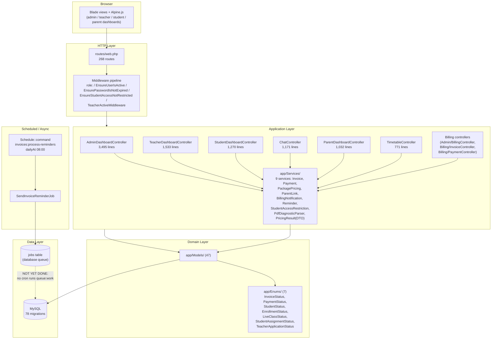
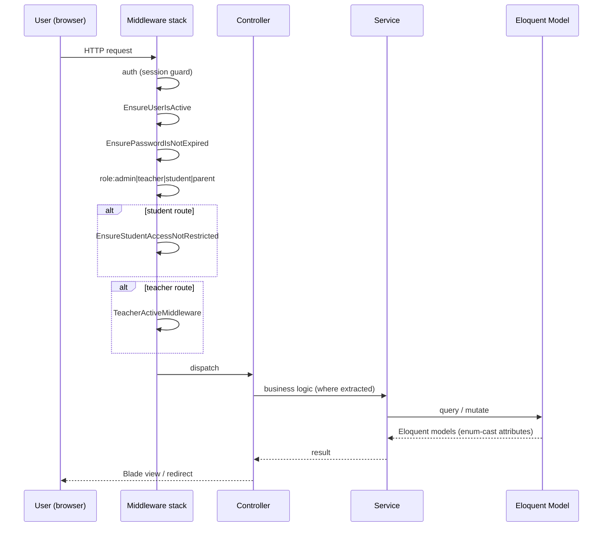
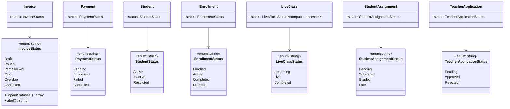
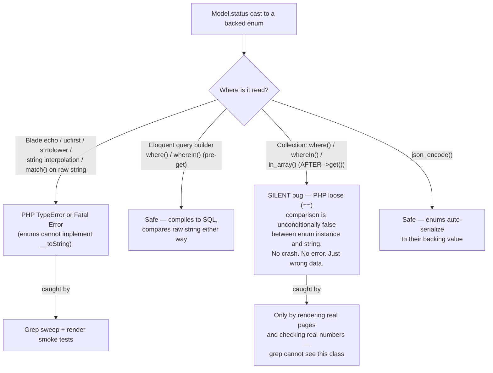
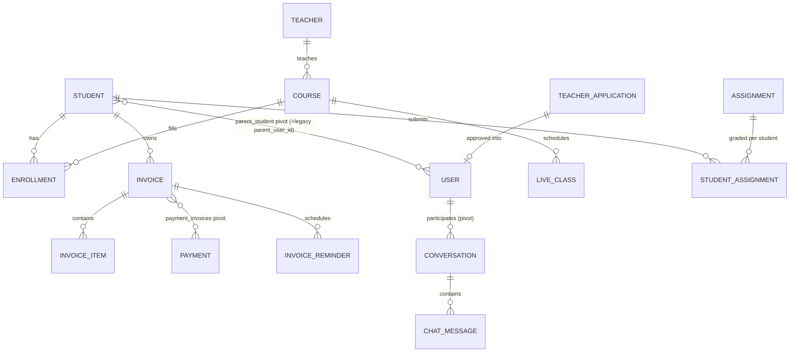

# Olympia Scholars — Architecture

**Status as of:** 2026-09-28, branch `khai-QA-refactor`, on top of the single `ed7d597` initial commit (all QA/refactor work below is currently uncommitted working-tree state, not yet merged to `main`).

This document describes the system as it actually is today, verified directly against the codebase (`php artisan test`, `git diff --stat` against the initial commit, `wc -l`, direct file reads) rather than from design intent. Where something is planned but not yet built, it is marked **NOT YET DONE** rather than omitted.

Companion document: [`E:\PROJECTS\OLYMPIA-PROJECTS\Scholars\implementation_plan.md`](../implementation_plan.md) (chatbox spec) and the QA/refactor master plan at `C:\Users\kyouscireul\.claude\plans\what-i-need-to-peppy-mitten.md`.

---

## 1. Stack

| Layer | Value | Verified via |
|---|---|---|
| Framework | Laravel v12.64.0 | `composer show laravel/framework` |
| PHP | `^8.2` (running 8.3.28) | `composer.json`, `php -v` |
| DB | MySQL (`DB_CONNECTION=mysql`) | `.env` |
| Queue driver | `database` (`QUEUE_CONNECTION=database`) | `.env` |
| Test DB | in-memory SQLite (`phpunit.xml`) | Phase 1 audit — 4 raw-SQL sites, zero MySQL-specific functions, confirmed a legitimate target |
| Frontend | Blade + Alpine.js + Tailwind (no SPA framework) | `resources/views`, `tailwind.config.js` |
| Deployment target | Shared/cPanel hosting, no persistent worker process | Plan decision #4 |

---

## 2. Component Overview



**Known architectural weak point, unchanged by this pass:** the queue is configured and a job (`SendInvoiceReminderJob`) is dispatched daily by `invoices:process-reminders`, but nothing on the host actually consumes the `jobs` table — no `queue:work` cron entry exists. Reminders almost certainly accumulate without sending. This is Phase 5 scope and has not been touched.

---

## 3. Request / Authorization Flow



`tests/Feature/RouteAuthorizationMatrixTest.php` (Phase 1) introspects the live route table at runtime — not a hand-maintained list — and asserts all 204 `role:`-gated routes (107 admin, 41 teacher, 32 student, 24 parent) reject every other role and guests. 816 individual assertions in one test method.

---

## 4. Chat Subsystem — Before/After (Phase 2)

The chatbox was found half-migrated: a floating-widget stack (`Conversation`/`ChatMessage`) and a legacy full-page stack (`Message`/`MessageController`) coexisted with **separate, non-overlapping data**.

```mermaid
graph LR
    subgraph Before["BEFORE — two parallel, disconnected stacks"]
        direction TB
        W1["Floating widget<br/>(Alpine.js component)"] --> CM1["ChatController<br/>REST endpoints"]
        CM1 --> Conv1["Conversation /<br/>ChatMessage tables"]
        FP1["/student/messages<br/>/teacher/messages"] --> MC1["MessageController"]
        MC1 --> Msg1["messages table"]
        Admin1["Admin activity feed"] --> Msg1
        Note1["A widget message is invisible<br/>at /student/messages.<br/>Unread counts diverge."]
    end

    subgraph After["AFTER — one stack, full-page view built but disabled"]
        direction TB
        W2["Floating widget"] --> CM2["ChatController<br/>same REST endpoints"]
        FP2["chat/_full-page-messenger.blade.php<br/>(built, routes commented out<br/>per repo-owner direction)"] --> CM2
        CM2 --> Conv2["Conversation / ChatMessage<br/>(single source of truth)"]
        Admin2["Admin activity feed<br/>(repointed)"] --> Conv2
        Deleted["Message model,<br/>MessageController,<br/>8 legacy AJAX routes,<br/>messages table:<br/>ALL DELETED<br/>(down-reversible migration)"]
    end

    Before -. Phase 2 .-> After
```



Also fixed in Phase 2: `ChatController::authorizeContact` now allows Parent↔Child (active guardianship only — a Phase-0 `pending` link correctly still grants zero chat access) and enforces the teacher-enrollment whitelist both directions. `getDirectory()` (the "who can I start a new chat with" list) previously never surfaced the counterpart at all — fixed, or the authorization fix alone would have been invisible in the UI.

---

## 5. Enum / Domain Modeling (Phase 3)

### 5.1 What changed

Seven `status`-bearing models moved from ad-hoc strings / class constants to native PHP backed enums:



`LiveClass.status` is a computed accessor (derives Upcoming/Live/Completed from `scheduled_at`/`duration_minutes`), not a simple `$casts` entry — it wraps the enum only at the read boundary; the internal computation and the `saving` hook's DB write stay raw strings, because the underlying MySQL column is a native `enum('upcoming','live','completed')`.

### 5.2 Two bug classes this surfaced



Confirmed empirically (not assumed):
```
php -r "enum X: string { case A = 'pending'; } var_dump(X::A == 'pending');"
→ bool(false)
```

**Real, live instances found and fixed of the silent (Collection) class**, both in `ParentDashboardController`:
- `dashboard()` — pending-payment totals, pending counts, and "last payment made" were unconditionally empty/null for **every parent** viewing their own billing dashboard, regardless of actual payment data.
- `payments()` — same pattern across 6 aggregate fields (`totalPaid`, `totalOutstanding`, `pendingCount`, `paidCount`, `latestPayment`, `pendingPayments`).

Fixed by switching to strict enum-case comparisons; the "Payment has no overdue state" phantom branches (a value that was never a valid `PaymentStatus`) were dropped rather than kept as dead code. New regression test `tests/Feature/ParentPaymentAggregationTest.php` renders both live pages with real pending + successful payments and asserts the view data is actually correct — verified to fail against the pre-fix code.

**Real, live instances of the crash (TypeError) class**: `ucfirst()` called directly on an enum instance in `admin/dashboard.blade.php` and `parent/dashboard.blade.php`. Missed by the existing render smoke test because its fixtures didn't populate the specific relations those two lines read (`Invoice::paymentTransactions`, `$latestPayment`).

**A real security regression caught in the same pass**: `User::isAccountActive()` compared `$this->studentProfile->status === 'inactive'` (raw string) against the newly enum-cast `Student.status` — always `false` post-conversion, meaning a restricted/inactive student would have silently bypassed the login gate. Fixed before it shipped.

**Known, explicit gap**: `FeeStructure` still uses `const STATUS_*` string constants — it was not one of the plan's seven named Phase 3 models and was left untouched. This is the one remaining status-like class-constant block in `app/Models/`.

---

## 6. Domain Model (core billing/enrollment slice)



47 models total in `app/Models/`. This diagram covers the slice touched by Phases 0–3; it is not exhaustive of all 47.

---

## 7. QA / Refactor Phase Status

Per `C:\Users\kyouscireul\.claude\plans\what-i-need-to-peppy-mitten.md` (v2):

| Phase | Status | One-line result |
|---|---|---|
| 0 — Containment | ✅ Done | Closed an unauthenticated parent-child-hijack chain; randomized/emailed all previously-derivable passwords; throttled account creation |
| 1 — Safety Net | ✅ Done | Runtime route-authorization matrix (816 checks); 6 model factories; dashboard smoke tests (found + fixed a hardcoded `teacher_id=1` crash) |
| 2 — Chat Consolidation | ✅ Done | Rebuilt full-page messenger on the winning stack (shipped disabled per repo-owner direction); legacy `Message` stack deleted outright; Parent↔Child chat enabled |
| 3 — Enums / Domain Modeling | ✅ Done | 7 backed enums; found and fixed 2 crash sites + 2 live silent-data-bug methods + 1 login-gate security regression |
| 4 — Modularity | ⬜ Not started | Controllers listed in §2 are still their original (pre-refactor) sizes — no extraction has occurred |
| 5 — Scalability | ⬜ Not started | Queue-worker cron unproven; no FK/index audit; `$fillable` privilege columns untightened |
| 6 — CI & Static Analysis | ⬜ Not started | No `.github/workflows`, no `phpstan.neon`/Larastan, no `pint.json` |

---

## 8. Before / After — Verified Metrics

All "Before" figures are read directly from the single initial commit (`git show ed7d597:<path>`), not from memory. All "After" figures are read from the current working tree. Both were measured in this session.

| Metric | Before (`ed7d597`) | After (current) | Verified via |
|---|---|---|---|
| Test methods (total) | 67 (across 15 files, incl. dead `ExampleTest.php`) | **110** (108 passing + 2 intentionally skipped) across 22 Feature files + 7 Auth files + 1 Unit file | `php artisan test`; per-file `grep -c "public function test_"` |
| Test assertions | not separately tracked | 295 | `php artisan test` output |
| Native PHP backed enums (`app/Enums/`) | 0 | 7 | `git ls-tree` vs `ls app/Enums` |
| Models with `status` cast to an enum | 0 | 6 direct `$casts` + 1 computed-accessor (`LiveClass`) = 7 | `grep "Status::class" app/Models/*.php` |
| `const STATUS_*` constants remaining in `app/Models/` | 14 | 4 (all in `FeeStructure`, explicitly out of Phase 3 scope) | `grep -c "const STATUS_"` before/after |
| Middleware | 4 (`EnsureStudentAccessNotRestricted`, `EnsureUserIsActive`, `RoleMiddleware`, `TeacherActiveMiddleware`) | 5 (+ `EnsurePasswordIsNotExpired`) | `git ls-tree` vs `ls app/Http/Middleware` |
| `app/Services/` | 8 files | 9 files (+ `ParentLinkService`) | `git ls-tree` vs `ls app/Services` |
| Chat data model | 2 parallel, disconnected stacks (`Message` + `Conversation`/`ChatMessage`) | 1 stack (`Conversation`/`ChatMessage`); `Message` model, `MessageController`, `messages` table, 8 legacy routes deleted | file diff, migration `2026_09_28_160633_drop_legacy_messages_table.php` |
| Migrations | 76 | 78 | `git ls-tree` count vs `ls` count |
| Routes in `routes/web.php` | 273 | 268 | `grep -c "Route::"` before/after (net delta reflects Phase 2's legacy chat route deletions net of Phase 0/3 additions) |
| Inline `->validate()` / `Validator::make()` calls in controllers | 96 | 97 | grep before/after (**unchanged** — this is Phase 4 scope, not yet touched) |
| `FormRequest` classes | 2 (`LoginRequest`, `ProfileUpdateRequest`) | 2 (unchanged) | `git ls-tree` vs `ls app/Http/Requests` |
| Largest controller (`AdminDashboardController`) | 3,449 lines | 3,495 lines | `wc -l` before/after — **grew**, not shrank; enum-safety fixes added lines, Phase 4 (extraction) has not started |
| `TeacherDashboardController` | 1,532 lines | 1,533 lines | `wc -l` |
| `StudentDashboardController` | 1,258 lines | 1,270 lines | `wc -l` |
| `ChatController` | 1,086 lines | 1,171 lines | `wc -l` — grew via Phase 2's directory-visibility + authorization work |
| `ParentDashboardController` | 1,022 lines | 1,032 lines | `wc -l` |
| `TimetableController` | 771 lines | 771 lines | `wc -l` — untouched so far |
| CI workflow | none | none (unchanged) | `.github/workflows` absent both times |
| Larastan / `phpstan.neon` | none | none (unchanged) | absent both times |
| `pint.json` | none | none (unchanged) | absent both times |
| Files changed since initial commit | — | 56 modified, 4 deleted, 29 added (89 total paths) | `git status --short` |

**Honest reading of this table:** Phases 0–3 were a security, correctness, and data-model pass — they did not reduce controller size or add static analysis, because that is explicitly Phase 4's and Phase 6's job, neither of which has started. Controllers got slightly *larger* through this window because enum-safety and bug fixes were added in place, not extracted. The test suite is the one line that moved unambiguously in the right direction: from 67 methods (many pre-existing, unrelated to this effort) to 110, with the newest ones (`ParentPaymentAggregationTest`, `LiveClassStatusTest`, `BillingEnumRenderSmokeTest`) specifically written to catch classes of bug that static grep provably could not.

---

## 9. Deliberately Deferred / Not Yet Done

Stated explicitly so nothing here is mistaken for complete:

- **Phase 4 (Modularity)**: no controller extraction into per-domain services has happened yet. All six controllers listed in §8 remain monolithic.
- **Phase 5 (Scalability)**: the queue is dispatching jobs into the `jobs` table but nothing consumes them — no `queue:work` cron is registered. No FK/index audit performed. Mass-assignable privilege columns (`User.role`, `Student.status`, `Invoice.status`/`amount_paid`, etc.) remain untightened.
- **Phase 6 (CI)**: no CI pipeline, no Larastan/PHPStan, no Pint config exist in this repository as of this writing.
- **`FeeStructure` enum conversion**: not part of Phase 3's named scope; its `const STATUS_*` constants remain.
- **Merge cadence**: the plan calls for shipping each phase as its own small PR; in practice all of Phases 0–3 currently sit as one uncommitted working-tree diff against the single initial commit — nothing has been merged to `main` yet.
