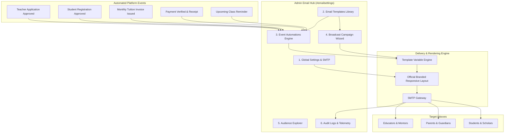

# Olympian Scholars — Enterprise Email Management System
## Official Administrator & Operations User Manual

---

### Document Overview
This manual provides instructions for administrators, academic coordinators, and operations staff on configuring, managing, and operating the **Enterprise Email Management System** in the Olympian Scholars platform.

---

## 1. System Overview & Core Capabilities

The **Olympia Scholars Email Management System** is an enterprise-grade communications hub designed to manage institutional email delivery, automated student/parent/educator notifications, and broadcast campaigns.



### Key Highlights:
- **Zero-Coding Customization**: Create, update, preview, and assign email layouts through visual admin modals.
- **Dynamic Variable Substitution**: Automatically inject personalized names, generated initial passwords, invoice balances, student IDs, and class links.
- **Event-Driven Automations**: Automatically dispatch branded notifications when key actions occur (e.g. teacher approvals, invoice creation, payment confirmations).
- **Idempotency Safeguard**: Built-in cryptographic duplicate suppression ensures no user receives duplicate emails if a button is clicked multiple times.
- **Enterprise Telemetry**: Every dispatched email is tracked in real-time with delivery timestamps, failure messages, and a 1-click retry engine.

---

## 2. Navigating to the Email Management Hub

1. Open your browser and navigate to:
   `http://127.0.0.1:8000/login`
2. Log in with your **Administrator** credentials.
3. On the left navigation sidebar of your **Admin Dashboard**, click on **Email Settings** (or navigate directly to `http://127.0.0.1:8000/admin/dashboard#emailsettings`).
4. At the top of the hub, you will see the **6 Dedicated Sub-Tabs**:

| Sub-Tab | Purpose |
| :--- | :--- |
| **Email Settings** | Global sender identities, SMTP credentials, reply-to routing, header banners, and test sender. |
| **Email Templates** | Library of institutional templates with visual editor, merge variable drawer, and live previews. |
| **Email Blast / Campaigns** | 5-step broadcast campaign wizard for scheduled or immediate mass announcements. |
| **Automations** | System event rules connecting platform actions to specific templates. |
| **Recipients & Audience** | Audience cohorts explorer with parent-child linkage and privacy isolation. |
| **Email Logs** | Live audit log with provider delivery statuses, error diagnostics, and CSV export. |

---

## 3. Sub-Tab 1: Email Settings & Global Branding

Before sending any emails, verify your institutional sender identities.

### Configurable Fields:
1. **Sender Display Name**: The name shown in the recipient's inbox (e.g., `Olympian Scholars` or `Olympia Education Malaysia`).
2. **Sender Email Address**: The address from which emails originate (e.g., `info@olympia-education.com`).
3. **Reply-To Email Address**: The inbox where recipient replies are routed (e.g., `support@olympianscholars.com`).
4. **Header Banner Image**:
   - Upload your official branded banner image (`PNG` or `JPG`, recommended width: `600px`).
   - The system embeds this banner via RFC-compliant CID inline attachment so it renders in Gmail, Outlook, Apple Mail, and mobile clients even if external image loading is blocked.
5. **Institutional Footer Notice**: Legal disclaimer and institutional contact information displayed at the bottom of all communications.

> [!TIP]
> **Sending a Quick Test**:
> Click the **Send Quick Test** button at the top right of the header bar to immediately send a sample email to your admin address and verify mail server connectivity.

---

## 4. Sub-Tab 2: Email Templates Library & Editor

Templates control the subject line, messaging, merge tags, and button links for all communications.

### 4.1 Template Categories
- **Greetings & Onboarding**: Account welcomes, credentials notices, registration approvals.
- **Billing & Payment**: Invoices, payment receipts, balance reminders, overdue notices.
- **Class & Timetable**: Schedule changes, meeting links, attendance notices.
- **Academic & Progress**: Assessment scores, report cards, topic mastery updates.
- **Renewal & Re-enrollment**: Term renewals, feedback requests.
- **General Notices**: Administrative announcements.

### 4.2 Creating or Editing a Template
1. In the **Email Templates** sub-tab:
   - Click **+ New Template** to create a blank template.
   - Click the **Edit** (pencil icon) button on any existing card/row.
2. The **Edit Email Template** modal opens with the following fields:

```
┌────────────────────────────────────────────────────────────────────────┐
│ Edit Email Template                                                    │
├────────────────────────────────────────────────────────────────────────┤
│ Template Name:   [ Teacher Application Approved & Credentials        ] │
│ Category:        [ Greetings & Onboarding                          ▼ ] │
├────────────────────────────────────────────────────────────────────────┤
│ Email Subject:   [ Educator Application Approved — {{platform_name}} ] │
├────────────────────────────────────────────────────────────────────────┤
│ Linked Automation Trigger (Optional):                                  │
│ [ Teacher Application Approved Notification (Event: When admin ...) ▼ ] │
├────────────────────────────────────────────────────────────────────────┤
│ Plain-Text Body:              [ 🏷️ Insert Dynamic Variable ]           │
│ ┌────────────────────────────────────────────────────────────────────┐ │
│ │ Dear {{teacher_name}},                                             │ │
│ │                                                                    │ │
│ │ Congratulations! Your educator application for {{platform_name}}   │ │
│ │ has been officially approved.                                      │ │
│ │                                                                    │ │
│ │ YOUR LOGIN CREDENTIALS                                             │ │
│ │ Login Portal: {{portal_url}}                                       │ │
│ │ Registered Email: {{teacher_email}}                                │ │
│ │ Initial Password: {{temp_password}}                                │ │
│ └────────────────────────────────────────────────────────────────────┘ │
├────────────────────────────────────────────────────────────────────────┤
│ CTA Button Label: [ Access Educator Portal ]  URL: [ {{portal_url}} ] │
├────────────────────────────────────────────────────────────────────────┤
│ [ 👁️ Live Preview ]                              [ Cancel ] [ Save ]  │
└────────────────────────────────────────────────────────────────────────┘
```

3. **Linked Automation Trigger**: You can connect an automated trigger to this template directly from this dropdown.
4. **CTA Button**: Provide a button label and destination URL (or dynamic variable `{{portal_url}}`).
5. Click **Live Preview** to simulate desktop and mobile inbox rendering.
6. Click **Save Template**.

### 4.3 Complete Dynamic Variables Dictionary

Click the **Insert Dynamic Variable** button to open the variable drawer and insert any tag at your cursor position:

#### Teacher & Educator Tags
| Variable | Description | Sample Output |
| :--- | :--- | :--- |
| `{{teacher_name}}` | Educator full name | `Dr. Ahmad bin Zulkifli` |
| `{{teacher_email}}` | Educator login email | `ahmad@example.com` |
| `{{teacher_phone}}` | Educator phone number | `+60 12-345 6789` |
| `{{temp_password}}` | Auto-generated initial password | `AH345678` |
| `{{ic_number}}` | IC / Passport number | `900512-10-5678` |

#### Parent & Student Tags
| Variable | Description | Sample Output |
| :--- | :--- | :--- |
| `{{parent_name}}` | Parent / Guardian full name | `Puan Siti Aminah` |
| `{{parent_email}}` | Parent registered email | `siti@example.com` |
| `{{parent_phone}}` | Parent contact number | `+60 19-876 5432` |
| `{{student_name}}` | Student full name | `Danish bin Farhan` |
| `{{student_id}}` | Student reference ID | `STU-00142` |
| `{{student_level}}` | Academic level / Grade | `Form 5 SPM` |

#### Billing & Invoices Tags
| Variable | Description | Sample Output |
| :--- | :--- | :--- |
| `{{invoice_number}}` | Official invoice number | `INV-2026-0042` |
| `{{invoice_amount}}` | Total invoice sum | `RM 350.00` |
| `{{amount_paid}}` | Paid portion | `RM 350.00` |
| `{{outstanding_amount}}` | Balance remaining | `RM 0.00` |
| `{{due_date}}` | Payment due date | `15 Nov 2026` |
| `{{receipt_number}}` | Receipt reference | `REC-2026-0038` |

#### General Institutional Tags
| Variable | Description | Sample Output |
| :--- | :--- | :--- |
| `{{platform_name}}` | Brand title | `Olympian Scholars` |
| `{{portal_url}}` | Login portal link | `http://127.0.0.1:8000/login` |
| `{{support_email}}` | Admissions/support email | `info@olympia-education.com` |
| `{{current_date}}` | Today's formatted date | `23 Oct 2026` |

---

## 5. Sub-Tab 4: Event-Driven Automations

Automations execute background email dispatches when platform events occur.

### 5.1 Viewing the Automations Table
Navigate to the **Automations** sub-tab. You will see a table listing all system event triggers:

| Event Trigger & Key | Category | Assigned Template | Status | Actions |
| :--- | :--- | :--- | :--- | :--- |
| **Teacher Application Approved Notification**<br>`teacher_application_approved` | Greetings | Teacher Application Approved & Credentials | **Active** | `[Assign]` `[▶ Test]` |
| **Registration Approved & Welcome**<br>`registration_approved` | Greetings | Registration Approved | **Active** | `[Assign]` `[▶ Test]` |
| **New Invoice Generated**<br>`invoice_issued` | Payment | New Invoice Issued | **Active** | `[Assign]` `[▶ Test]` |
| **Payment Confirmation & Receipt**<br>`payment_confirmed` | Payment | Payment Confirmation | **Active** | `[Assign]` `[▶ Test]` |

### 5.2 Assigning a Template to an Automation
There are **two ways** to link a template to an automation:

#### Method A: Directly from the Automations Sub-Tab
1. Find the automation row in the table (e.g., `Teacher Application Approved Notification`).
2. In the Action column, click the **`Assign`** button.
3. In the popup modal:
   - Select your desired template from the dropdown.
   - Leave **Dispatch Delay** at `0` for immediate dispatch (or specify minutes to delay).
4. Click **Save & Assign**.

#### Method B: Directly from the Template Editor Modal
1. Open the **Email Templates** sub-tab &rarr; Click **Edit** on your template.
2. In the **Linked Automation Trigger** dropdown, select the target automation rule.
3. Click **Save Template**.

### 5.3 Enabling or Disabling an Automation
Click the status pill (**Active** / **Disabled**) in the table to toggle the trigger:
- **Active (Green)**: The system fires the assigned email whenever the event occurs.
- **Disabled (Gray)**: Event actions proceed normally in the app, but no email is sent.

### 5.4 Testing an Automation Trigger
1. Click the **Test Fire** icon (`▶`) on any automation row.
2. Enter your email in the prompt modal.
3. Click **Send Test Trigger**.
4. The system sends a simulated email with sample data to your inbox.

---

## 6. Sub-Tab 3: Email Blast / Broadcast Campaigns

Use this tool to send mass announcements, newsletters, or urgent notices to specific cohorts.

### The 5-Step Campaign Wizard:
1. **Click "New Email Blast"** at the top right of the hub.
2. **Step 1 — Details**: Enter a Campaign Name, Category, and internal description.
3. **Step 2 — Target Audience**: Select your recipient cohort:
   - *All Parents*
   - *All Students*
   - *Active Enrolled Scholars*
   - *Upper Secondary Form 4 & 5*
   - *Overdue Invoice Balances*
4. **Step 3 — Content**: Select an existing template from your library or compose a custom subject and body.
5. **Step 4 — Schedule**:
   - Choose **Send Immediately** (dispatched via background queue).
   - Choose **Schedule for Later** (select specific date and time).
   - Choose **Save as Draft** (leaves campaign editable).
6. **Step 5 — Confirmation**: Review audience recipient count, subject, and preview, then click **Launch Campaign**.

---

## 7. Sub-Tab 6: Email Logs & Provider Telemetry

Every email sent by the platform is logged for auditability and compliance.

### 7.1 Reading Log Statuses
- **Sent / Delivered (Green)**: Successfully accepted and transferred by your SMTP server.
- **Queued (Amber)**: Sitting in the job queue waiting for dispatch worker.
- **Failed (Red)**: The mail server rejected the message (e.g. invalid recipient, SMTP timeout, or mailbox full).

### 7.2 Diagnosing and Retrying Failed Emails
1. Click on any log row to open the **Email Dispatch Audit Record** modal.
2. View recipient address, dispatch attempts, rendered subject, and preview.
3. If delivery failed, inspect the **Provider Error** box (e.g., `SMTP Connection timeout on mail.olympia-education.com:465`).
4. Click the **Retry** icon to re-attempt dispatching to that recipient.

### 7.3 CSV Export
Click **Export CSV** at the top of the logs table to download an Excel-ready audit spreadsheet of all communications.

---

## 8. Walkthrough: Setting Up Educator Approval Credentials Email

Here is the exact workflow for configuring teacher approval credentials:

```
[ Step 1: Open #emailsettings-templates ]
                   │
                   ▼
[ Step 2: Edit 'Teacher Application Approved & Credentials' ]
                   │
                   ├─ Check Subject: "Educator Application Approved — {{platform_name}}"
                   ├─ Ensure Body includes:
                   │    Email: {{teacher_email}}
                   │    Password: {{temp_password}}
                   │    Portal: {{portal_url}}
                   └─ Linked Automation: "Teacher Application Approved Notification"
                   │
                   ▼
[ Step 3: Click 'Save Template' ]
                   │
                   ▼
[ Step 4: Open #emailsettings-automations ]
                   │
                   └─ Verify 'Teacher Application Approved Notification' is Active (Green)
                   │
                   ▼
[ Result: When an admin approves any educator application, ]
[ the teacher automatically receives their login email and password ]
```

---

## 9. Frequently Asked Questions & Troubleshooting

### Q1: The educator didn't receive their password email. Where do I check?
1. Go to **Email Logs** (`#emailsettings-logs`).
2. Search the teacher's email address in the search box.
3. If marked **Failed**, click on the log to read the provider error message (e.g. wrong SMTP password, or invalid mailbox).
4. If marked **Sent**, advise the educator to check their Spam/Junk folder and mark the sender as "Not Spam".

### Q2: How is the educator's initial password generated?
The system uses the formula:
$$\text{First 2 letters of Educator Name (uppercase)} + \text{Last 6 digits of IC/Passport}$$
*(Example: For applicant **Aisyah** with IC **950812-14-5678**, the initial password is **`AI145678`**).*

### Q3: What happens if I disable an automation?
If an automation is disabled in the Automations table, approving an application in the dashboard proceeds normally, but the automated email is skipped.

### Q4: Can I test an automation without approving a real applicant?
Yes. Go to the **Automations** sub-tab and click the **Test Fire** icon (`▶`) next to the automation. Enter your personal email address to receive a simulation email with sample data.
