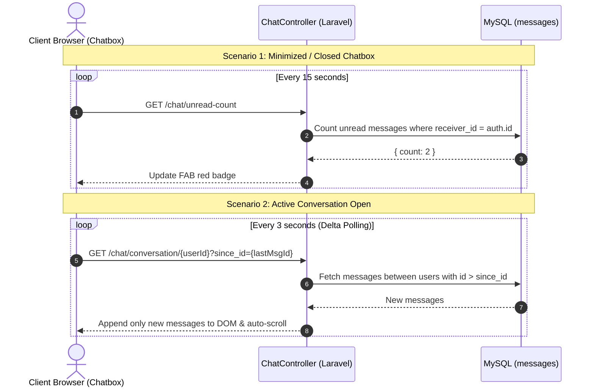

# 📋 Implementation Plan: Floating Chatbox with Parental Monitoring & Polling

## Executive Summary
This document provides the complete technical specifications and phased execution plan for the **bottom-right floating chatbox widget**. The system connects all four roles (**Student, Parent, Teacher, and Admin**) with direct user-to-user messaging, provides **Parental Child Monitoring** capabilities, and runs on an **optimized HTTP polling engine**.

---

## 1. Visual & Component Architecture

Based on the reference design, the widget is docked persistently at the bottom-right corner across all dashboard layouts.

```
┌─────────────────────────────────────────────────────────────┐
│  Dashboard Content (Student / Parent / Teacher / Admin)     │
│                                                             │
│                                  ┌───────────────────────┐  │
│                                  │ [Avatar] Jane Doe  ↻  │  │ Header (Vibrant Sky Blue)
│                                  │ Teacher • Online      │  │
│                                  ├───────────────────────┤  │
│                                  │ (•) Adam ↔ Ms. Sarah  │  │ Parental Monitor Indicator (if active)
│                                  ├───────────────────────┤  │
│                                  │ 👤 [ Hello! ]         │  │ Message Stream
│                                  │      [ Sent msg ]     │  │ (Received Left / Sent Right)
│                                  ├───────────────────────┤  │
│                                  │ [📷] Send A Message [➤]│  │ Bottom Input Bar
│                                  └───────────────────────┘  │
│                                              ┌───┐          │
│                                              │ ✕ │          │ Floating Action Button (FAB)
│                                              └───┘          │ (Chat bubble when closed, '✕' when open)
└─────────────────────────────────────────────────────────────┘
```

### Component Breakdown
1. **Floating Action Button (FAB)**:
   - Position: Fixed at `bottom-6 right-6` with `z-50`.
   - Circular button in brand sky blue (`#0ea5e9` / Tailwind `bg-sky-500`).
   - Unread badge (red pill with count) when closed.
   - Dynamic icon: Chat bubble when closed, `✕` close icon when open.
2. **Chat Popup Card**:
   - Fixed at `bottom-22 right-6` (width: 375px, max-height: 580px, responsive full-width on mobile).
   - **Header**: Sky-blue header with circular contact avatar, contact name, role/status tag, navigation back button (`←`), and refresh button (`↻`).
   - **Body**: Custom thin scrollbars, date separators ("Today", "Yesterday"), gray left-aligned received bubbles, and sky-blue right-aligned sent bubbles.
   - **Footer**: Attachment icon (camera/paperclip), text input (`Send A Message...`), and send button (`➤`).

---

## 2. Multi-Role Interaction & Parental Monitoring

### Role Communication Rules
| Role | Can Chat With | Can Receive From | Parental Monitoring Mode |
| :--- | :--- | :--- | :--- |
| **Student** | Enrolled Teachers, Admin Support | Enrolled Teachers, Admin | *N/A (Monitored by Parents)* |
| **Teacher** | Enrolled Students, Parents of Students, Admin | Students, Parents, Admin | *N/A* |
| **Parent** | Children's Teachers, Admin Support, Child | Teachers, Admin, Child | **Full Read-Only Audit of Linked Children's Chats** |
| **Admin** | Any User (Teacher, Student, Parent) | All Users | Support & management oversight |

### 👨‍👧‍👦 Parental Child Monitoring Flow
When a **Parent** opens the chatbox:
1. Two main tabs are visible: **"My Chats"** and **"Monitor Child (👁️)"**.
2. Under "Monitor Child", the parent can choose from their linked children (from the `parent_student` pivot table: e.g. *Adam*, *Sara*).
3. The parent views the list of teachers and administrators their child has conversed with.
4. Selecting a conversation opens a **Read-Only Audit Stream** of the chat.
5. A prominent banner displays:  
   > [!NOTE]  
   > **Parental Monitoring Mode (Read-Only):** You are auditing the conversation between **Adam** and **Teacher Sarah**. Direct messaging is disabled in this mode.

---

## 3. Polling Engine Architecture (`HTTP Polling`)



### Key Polling Engine Rules:
1. **Delta Polling (`since_id`)**: Only messages newer than `since_id` are fetched, keeping JSON payloads under 1 KB and database queries sub-millisecond.
2. **Adaptive Polling Intervals**:
   - Active Chat Window: **3.0 seconds**
   - Contact List: **8.0 seconds**
   - Minimized FAB: **15.0 seconds**
3. **Tab Inactivity Detection**: Uses `document.visibilityState`. Pauses polling when the browser tab is hidden to save client battery and server resources.

---

## 4. API & Route Specifications

All endpoints are protected under the `auth` middleware:

```php
Route::middleware(['auth'])->prefix('chat')->name('chat.')->group(function () {
    // Contact Discovery & Unread Count
    Route::get('/contacts', [ChatController::class, 'getContacts'])->name('contacts');
    Route::get('/unread-count', [ChatController::class, 'getGlobalUnreadCount'])->name('unread-count');

    // Direct Conversation & Send
    Route::get('/conversation/{userId}', [ChatController::class, 'getConversation'])->name('conversation');
    Route::post('/send', [ChatController::class, 'sendMessage'])->name('send');
    Route::post('/upload-attachment', [ChatController::class, 'uploadAttachment'])->name('upload-attachment');

    // Parental Monitoring Endpoints (Parent Role Only)
    Route::middleware(['role:parent'])->prefix('monitor')->name('monitor.')->group(function () {
        Route::get('/children', [ChatController::class, 'getMonitoredChildren'])->name('children');
        Route::get('/child/{childStudentId}/contacts', [ChatController::class, 'getChildContacts'])->name('child-contacts');
        Route::get('/child/{childStudentId}/conversation/{contactId}', [ChatController::class, 'getChildConversation'])->name('child-conversation');
    });
});
```

---

## 5. Security & Authorization Guardrails

1. **Strict Relationship Verification**:
   - Parents can **only** monitor children linked in `parent_student` where `parent_user_id == auth()->id()`.
   - Prevents unauthorized child surveillance or horizontal privilege escalation.
2. **Communication Whitelist**:
   - A student cannot arbitrarily message students outside their scope.
   - Enforces teacher-student enrollment relationship checks on message dispatch.
3. **XSS Protection**:
   - All message bodies are escaped before rendering.
4. **CSRF Validation**:
   - All POST requests include the Laravel `X-CSRF-TOKEN` header.

---

## 6. Phased Implementation Roadmap

- [ ] **Phase 1: Database Migration & Schema Adjustments**
  - Add optional `attachment_url` and `attachment_type` columns to the `messages` table.
  - Review indexes on `(sender_id, receiver_id, id)` for optimized delta polling.
- [ ] **Phase 2: Backend Controller (`App\Http\Controllers\ChatController`)**
  - Implement role-based contact resolver (`getContacts`).
  - Implement delta conversation fetcher (`getConversation` with `since_id`).
  - Implement message dispatch (`sendMessage`) with role-based authorization.
- [ ] **Phase 3: Parental Monitoring Module**
  - Implement `getMonitoredChildren`, `getChildContacts`, and `getChildConversation`.
  - Enforce parent-child verification via `parent_student` pivot.
- [ ] **Phase 4: Floating Chatbox Frontend Component (`<x-floating-chatbox />`)**
  - Build Alpine.js-powered floating widget.
  - Implement circular FAB with unread badge and toggle icon (`✕` / chat bubble).
  - Implement views: Contact List, Active Chat, and Child Monitoring Mode.
  - Build chat bubbles matching reference image (avatar, received gray bubble, sent blue bubble, input bar).
- [ ] **Phase 5: Polling Engine Client Integration**
  - Implement 3s / 8s / 15s adaptive polling with `since_id`.
  - Handle browser tab visibility change events.
- [ ] **Phase 6: Master Layout Integration & End-to-End Testing**
  - Inject widget into `dashboard.blade.php`, `teacher-layout.blade.php`, and `admin-layout.blade.php`.
  - Verify chat flows across all roles: Student ↔ Teacher, Parent ↔ Teacher, Parent monitoring Child, and Admin.
